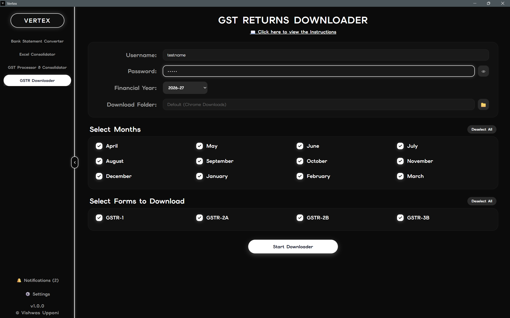

# GSTR Downloader

GSTR Downloader is an official addon module for the **Vertex Application**. It automates the batch downloading of GST returns (GSTR-1, GSTR-2A, GSTR-2B, and GSTR-3B) directly from the official GST Portal across multiple return periods for a selected financial year. Designed to eliminate tedious manual downloads, it automates portal navigation and file retrieval while keeping credentials strictly in volatile memory.

> [!NOTE]
> **Internet Usage**: Requires an internet connection to connect to the official GST Portal (`services.gst.gov.in`) to download returns, and to download the browser driver during initial setup.

---

## 📸 Screenshots

### Downloader Interface

### Automated Download Demo

---

## ✨ Key Features

- **📥 Automated Batch Returns Retrieval**: Download GSTR-1, GSTR-2A, GSTR-2B, and GSTR-3B returns in bulk across selected months for the chosen financial year.
- **🔐 Secure Credential Handling**: Session tokens and portal credentials reside exclusively in volatile memory during the active session and are never saved to disk.
- **📅 Flexible Period & Form Selection**: Select any combination of return months (April through March) and specific GST return forms to download.
- **📁 Customizable Download Destination**: Save downloaded returns to your default downloads folder or specify a custom destination directory.
- **🗂️ Automatic Folder Organization**: Automatically organizes and sorts downloaded return files into separate dedicated folders.
- **⚡ Real-Time Progress Telemetry**: Live status updates and progress tracking throughout the automated download run.

---

## 📥 Installation

### Via Vertex Module Manager (Recommended)
1. Open the **Vertex Application**.
2. Go to **Settings** in the sidebar and then **Module Manager**.
3. Switch to the **Cloud Store** tab, locate **GSTR Downloader**, and click **Install**.
4. The addon will automatically download, install, and appear in your active sidebar navigation.

### Manual Package Installation
1. Download the latest release `.vtx` package from the [Releases](https://github.com/vishwasupponi/vtx-gstr-downloader/releases) page.
2. In Vertex Module Manager, click **"Install Local File"** and choose the downloaded package.

---

## 🚀 Getting Started

1. **Open Tool**: Select **GSTR Downloader** from the sidebar navigation.
2. **Configure Settings**: Enter your GST portal login credentials, select the financial year, choose the return months, and select the return forms (GSTR-1, GSTR-2A, GSTR-2B, GSTR-3B) you want to download.
3. **Start Download**: Click **"Start Downloader"** to launch the automated browser and begin downloading returns to your destination folder.

> For more information, check the **Instructions** manual inside Vertex.

---

## 🤝 Contributing & Security

- You are free to develop custom plugins for personal use. To propose a module for the official Cloud Store catalog or submit contributions, see [CONTRIBUTING.md](CONTRIBUTING.md).
- To report a security concern or review the security policy, see [SECURITY.md](SECURITY.md).

---

## 🙏 Acknowledgments

This module is built using various open-source libraries and components under their respective open-source licenses. Building this module would not have been possible without these foundational open-source technologies, and I thank all the original developers and maintainers of these projects for their contributions:

- **[Selenium](https://www.selenium.dev/)** – Browser automation engine for authenticated portal interaction and navigation.
- **[webdriver-manager](https://github.com/SergeyPirogov/webdriver_manager)** – Automated driver management and browser binary configuration.

---

## 📄 License

This project is licensed under the [GNU Affero General Public License v3 (AGPL-3.0)](LICENSE).

Developed by [Vishwas Upponi](https://vishwasupponi.blogspot.com/links).
